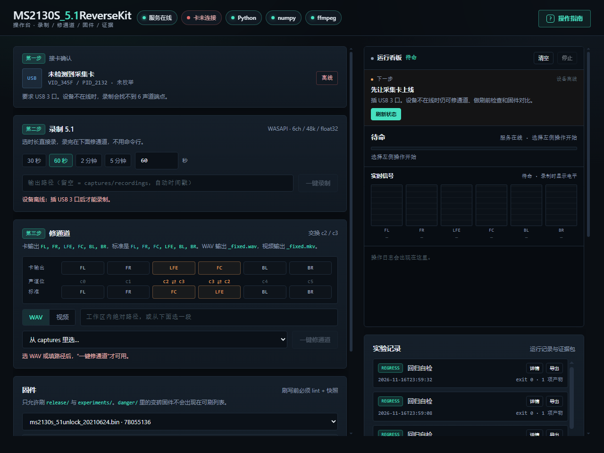
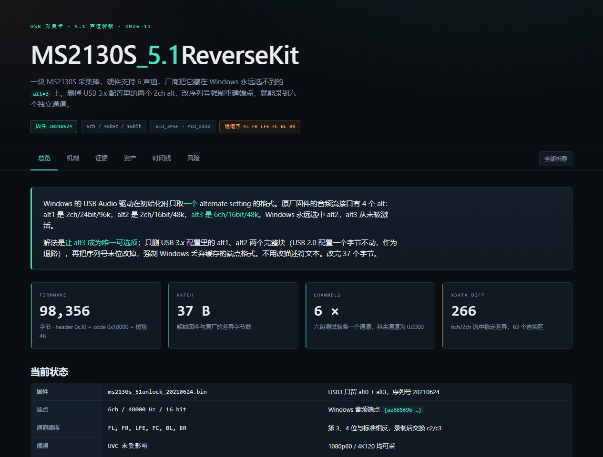

# MS2130S_5.1ReverseKit

> 5.1（6 声道）解锁的可复现工具包与实验记录。

| 项 | 内容 |
|---|---|
| 🖥️ 设备型号 | MS2130S |
| ✍️ 发起人 | HyDxin |
| 🎯 目标 | 让 Windows 认到 `6ch / 48kHz / 16bit`，录到六路独立通道 |
| 🚪 入口 | 双击根目录 `启动操作台.vbs`，默认打开 `http://127.0.0.1:8765/` |

> **结论**：芯片硬件支持 6 声道。厂商把 `6ch / 48kHz / 16bit` 挂在 USB 音频流接口的 `alt=3` 上，而 Windows 的 USB Audio 驱动只取一个 alternate setting，永远选不到它。把 USB 3.x 配置里的 alt1、alt2 整块删掉（USB 2.0 配置留作退路），再改序列号强制 Windows 重建音频端点，Windows 就只能选 alt3，录到的是六个独立通道。

## 🚀 快速上手

1. 🚀 **启动**：双击根目录 `启动操作台.vbs`。根目录只有这一个启动入口；`操作台.html`、`components.css`、`design-tokens.css` 都不是。
2. 🌐 **打开**：浏览器打开 `http://127.0.0.1:8765/`。默认端口 8765；被占用时启动器顺延到 8766–8769，并打开实际端口。
3. 🎛️ **操作**：在页面里按 7 步走：接卡确认 → 录制 → 修通道 → 刷前检查 → 读回快照 → 安全刷写 → 刷后验收。
4. 🛑 **关闭**：双击根目录 `停止操作台.vbs`；或者直接关掉浏览器，连续 30 分钟没操作后服务自动退出。页面里的“停止”只停当前任务，不是关服务。

首次启动会在 `runtime/` 内建 venv、安装 `numpy` 与 `imageio-ffmpeg`，之后复用；依赖与日志都留在项目目录内。

## 🖼️ 界面预览

| 操作台 | 项目全景 |
|---|---|
|  |  |

> 截图取自本机实际页面：操作台为待命状态，项目全景为总览页。设备在线后，操作台会显示端点与六路电平。

## 📌 当前状态

| 项 | 值 |
|---|---|
| 固件 | `firmware/release/ms2130s_51unlock_20210624.bin`（USB3 只留 alt0 + alt3，序列号 20210624） |
| 端点 | 6ch / 48000 Hz / 16 bit（端点格式；采集落 float32） |
| 通道顺序 | `FL, FR, LFE, FC, BL, BR`（第 3、4 位与标准相反，录制后交换 c2/c3） |
| 视频 | UVC 通路未受影响，1080p60 / 4K120 均可采 |
| 回退 | 刷 `firmware/release/ms2130s_backup.bin`，序列号还原 20210629 |

## 🧭 关键口径

| 口径 | 值 |
|---|---|
| 项目名 | `MS2130S_5.1ReverseKit` |
| 名称边界 | `MS2130S` 是芯片型号；正文提到项目只用项目名，文档文件名与固件名保持原样 |
| 页面步骤 | 7 个编号步骤：第一步接卡确认、第二步录制、第三步修通道、第四步刷前检查、第五步读回快照、第六步安全刷写、第七步刷后验收 |
| 指南节数 | 操作指南弹窗 8 节逐节说明（含启动、环境、故障速查），与页面 7 步不是同一套编号 |
| 端点格式 | 硬件端点 6ch / 48000 Hz / 16 bit |
| 采集落盘 | WASAPI 采集写 IEEE float32（32 bit 容器），`ops_config.json` 的 `sample_format` 指这一层 |
| 修通道输出 | ffmpeg 统一写 `pcm_s24le`（24 bit）；验收只针对采集 WAV，对 `_fixed.wav` 会 `format-fail` |

## 🖥️ 操作台

启动入口只有一个：根目录 `启动操作台.vbs` → 浏览器 `http://127.0.0.1:8765/` → 页面 `操作台.html`；关闭入口是根目录 `停止操作台.vbs`。默认端口 8765；被占用时启动器顺延到 8766–8769，并打开实际端口。

全程没有控制台窗口，服务在后台运行；关掉浏览器后按空闲阈值自动退出。启动入口只有 `启动操作台.vbs`，关闭入口是 `停止操作台.vbs`，文档索引仍只有 `docs/README.md`。

- 🧩 **首次启动**：在项目根的 `runtime/` 内建 venv、安装 `numpy` 与 `imageio-ffmpeg`（修通道优先用内置 ffmpeg），然后启动服务；之后复用同一套运行时。基础 Python 需要带 pip，依赖由它装进 venv。
- 📁 **运行边界**：所有运行时文件、独立 Python 依赖、临时文件、日志、录音和修通道输出都限制在项目目录内，不写 `%TEMP%`、用户 `Videos` 或 Windows 启动项。
- 🖥️ **页面功能**：录制、修通道、刷前检查、读回快照、安全刷写、刷后验收、固件对比、回归自检和打开文档。
- 🔒 **刷写门控**：只接受 `release/`、`experiments/`，要求设备在线、快照在当前服务启动后完成、通过基线校验、晚于最近一次刷写尝试，且属于当前设备实例。
- 📊 **反馈与记录**：录制时右侧六条电平条按 WAV 尾部刷新；修通道显示 ffmpeg 处理进度；刷写用 32 格块矩阵按时间估算；每次操作在“实验记录”卡生成一条 Run，可看详情、导出 zip 证据包。
- ❓ **操作指南**：右上角入口，第一次打开自动弹出（页面 7 步、指南 8 节），关闭后收进按钮，随时可再打开。

## 🗂️ 目录

| 目录 | 内容 | 入口 |
|---|---|---|
| `docs/` | 主题文档、资产清单、核对记录、交互式全景、对外指南、原始简报归档、README 截图 | `docs/README.md` |
| `firmware/` | `release/` 当前与回退、`experiments/` 实验镜像、`danger/` 变砖固件 | `firmware/README.md` |
| `registers/` | `XDATA` dump，按批次存放；不同批次不可直接比较 | `registers/README.md` |
| `captures/` | `evidence/` A 级证据、`archive/` 历史与对照、`video/` 抓帧、`recordings/` 新录制、`fixed/` 修通道输出 | `captures/README.md` |
| `tooling/` | `ops/` 操作台服务、`flash/` 刷写、`capture/` 录制与标定、`reverse/` 逆向脚本、`analysis/` 取证 | `tooling/README.md` |
| `runtime/` | 首次部署生成的 venv、日志、临时文件、pip 缓存；运行时目录，可整体重建 | — |
| `archive/` | `stick/` 早期 WinPE 恢复方案、重构前文本备份、`legacy-entry/` 旧启动服务脚本 | — |

## 📦 交付打包

体积随录音、视频与运行时变化，这里只按用途分档，不写死总量；需要当前数字时看目录属性，文件数看 `regress.py` 输出的 `files`。

- 🧳 `runtime/`：本机 venv、日志与临时文件，换机后首次双击 `启动操作台.vbs` 时重建。
- 🧪 `tooling/ops/runs/`：本机实验记录，含绝对路径。

各档都不带这两项。

| 档 | 内容 | 建议 | 说明 |
|---|---|---|---|
| 核心 | 根目录文件（页面、样式、启动/停止脚本、README）、`docs/`、`firmware/`、`tooling/`（不含 `runs/`）、`registers/` | 必带 | 启动、刷写、复现所需 |
| 证据 | `captures/evidence/` + `captures/video/` | 建议带 | A 级录音与抓帧；不带就没有可复算的证据 |
| 历史录音 | `captures/archive/` | 可选 | 历史对照录音；验证结论不需要 |
| 备份 | `archive/` | 可选 | 重构前文本与旧入口 |

- `firmware/danger/` 随 `firmware/` 一起带，页面与 README 都标了禁止刷；删掉它会让 `firmware/SHA256SUMS` 与回归少一条。
- `archive/`、`captures/archive/`、`firmware/danger/` 只按用途决定是否随包，项目内不删除。
- 接收方解压后仍走 `启动操作台.vbs` 单入口；首次双击 `启动操作台.vbs` 时在 `runtime/` 重建 venv，目标机需要带 pip 的 Python 3。

发布包在 `dist/MS2130S_5.1_console_20261117.zip`：带核心、`archive/`、`captures/evidence/`、`captures/video/`；不带 `captures/archive/`、`runtime/`、`tooling/ops/runs/`。包内 `发布说明.md` 写明运行要求与缺失项。该 zip 是打包时的快照，文案改动后未重新生成；对外发包前重新打包。

## 🧰 排障与复现命令

页面优先；以下命令只用于排障或复现，不作为第二入口。

```powershell
# 录制 5.1（页面失败时）
powershell -File tooling\capture\rec51.ps1 -Seconds 60

# 修通道：页面“一键修通道”；手动用 ffmpeg
ffmpeg -i in.wav -af "pan=5.1|c0=c0|c1=c1|c2=c3|c3=c2|c4=c4|c5=c5" -c:a pcm_s24le out.wav

# 刷任何固件前，先过描述符 lint（0 错误才刷）
python tooling\reverse\uac_desc_lint.py firmware\release\ms2130s_51unlock_20210624.bin

# 回退原厂（约 6 分钟，过程中不能拔 USB）
tooling\flash\ms213x_flash.exe -w firmware\release\ms2130s_backup.bin
```

刷完必须**断电**：拔卡身上的 USB 头，等 10 秒再插。拔 HUB 到电脑那根线不算断电。

## ⚙️ 三条关键机制

```text
USB 3.x 配置
  alt0   零带宽
  alt1   2ch / 24bit / 96k   ← 删
  alt2   2ch / 16bit / 48k   ← 删
  alt3   6ch / 16bit / 48k   ← 保留
USB 2.0 配置
  原厂 2ch                   ← 留作退路
```

1. 🧩 **描述符不由固件搬运。** USB 描述符由 SIE 硬件直接从 flash 固定区读取，固件只负责初始化与控制。所以改描述符后 Windows 立刻能识别，也解释了为什么改描述符不改变实际音频格式。
2. 🗺️ **固件按 `SET_INTERFACE` 的 alt 序号查死表。** alt1 → 2ch/24bit/96k，alt2 → 2ch/16bit/48k，alt3 → 6ch/16bit/48k。改描述符文本只骗 Windows，卡本身仍按 alt 序号出数据。
3. 🪟 **Windows 只暴露一个 alt 的格式。** 独占模式请求 6ch/8ch/96k 全部返回 `0x88890048`，只有被选中的那个 alt 可用。所以要拿 6 声道，必须让 alt3 成为唯一可选的 streaming 设置。

## 🚫 五条红线

- **只改格式字段可以反复试；改 `bNumEndpoints`、增删描述符是单向操作。** 结构不合法会让 Windows 拒绝整个配置描述符，连 HID 刷写通道一起消失。
- **刷写过程中不能拔 USB。** 刷完必须真断电，芯片只在启动时从 flash 加载描述符。
- **每次改描述符必须同时改序列号。** Windows 按设备实例缓存音频端点格式，不改序列号会一直沿用旧端点。
- **插 USB 2.0 口会走未改动的原厂配置，退回 2ch，不会损坏。** 这也是 USB3 配置改坏后的退路。
- **`firmware/danger/ms2130s_alt3only.bin` 是变砖固件，不要刷。** 它把 alt1/alt2 的 `bNumEndpoints` 置 0 却保留端点描述符，lint 报 4 处错误。

## 📚 文档

### 📄 主题文档

| 文档 | 定位 |
|---|---|
| `docs/01-结论与机制.md` | 结论、三层机制、37 字节改动 |
| `docs/02-固件与描述符.md` | 镜像结构、4 个 alt、镜像血统、lint |
| `docs/03-解锁与验证.md` | 刷写步骤、验证清单、OBS、回退 |
| `docs/04-通道映射与证据.md` | 通道顺序、两种标定、XDATA 三态对照 |
| `docs/05-变砖与救砖.md` | 事故、Linux usbfs、五条红线 |
| `docs/06-资产与复现.md` | 目录地图、文件索引、复现命令、依赖 |
| `docs/07-优化方案.md` | 痛点、分层方案、实施记录与验收 |

### 🔎 索引与参考

| 文档 | 定位 |
|---|---|
| `docs/README.md` | 文档地图与阅读顺序 |
| `docs/资产清单.md` | 逐文件角色、状态、SHA-256 |
| `docs/核对记录.md` | 固件校验、lint、XDATA 差量、录音复算、勘误表 |
| `docs/项目全景.html` | 六页交互式全景：总览 / 机制 / 证据 / 资产 / 时间线 / 风险 |
| `docs/MS2130S_5.1_解锁指南.md` | 对外分享版，自包含 |

### 🗃️ 历史

| 文档 | 定位 |
|---|---|
| `docs/archive/MS2130S_5.1_逆向简报.md` | 原始 20 节完整实验记录，历史版本 |

> 第一次读：`01 → 02 → 04`；要动手：`03`；担心变砖：`05`。

原始简报按时间顺序写，含失败实验与自我更正，正文里的节号引用都指向它。主题文档是从它提炼的检索入口，不替代原文。

## ✍️ 署名

本项目最初由 **HyDxin** 发起；当前仓库在此基础上整理为可复现的工具包与文档。
